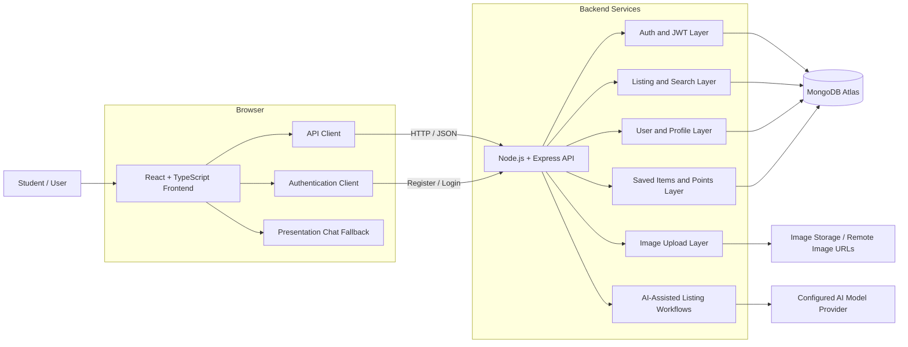

# CampusKart

<p align="center">
  <strong>AI-Enabled Campus Marketplace</strong><br />
  A trusted platform for students to buy, sell, and exchange products within their college community.
</p>

<p align="center">
  <a href="#overview">Overview</a> •
  <a href="#features">Features</a> •
  <a href="#system-architecture">Architecture</a> •
  <a href="#getting-started">Getting Started</a> •
  <a href="#demo-workflow">Demo</a>
</p>

<p align="center">
  
  
  
  
  
</p>

---

## Overview

CampusKart is a campus-focused marketplace for student-to-student commerce. It enables students to discover, list, sell, and exchange second-hand products in a localized and trusted environment.

The platform brings together secure account management, product listings, search and filtering, seller profiles, saved items, campus points, and buyer-seller communication. AI-assisted workflows help sellers create better descriptions, understand resale prices, and support moderation.

CampusKart is developed as an academic project for the **Department of Computer Science & Engineering — Artificial Intelligence** at **G. L. Bajaj Institute of Technology & Management**.

### Project goal

To provide an affordable, convenient, and trustworthy digital marketplace that helps students reuse products, reduce expenses, and build a sustainable campus economy.

---

## Problem Statement

Students frequently need affordable books, electronics, calculators, furniture, bicycles, notes, clothing, sports equipment, and hostel essentials. Existing general-purpose marketplaces are not designed around campus trust, local meetups, student budgets, or academic needs.

CampusKart addresses this gap by providing:

- A localized campus marketplace
- Direct student-to-student communication
- Product discovery designed around campus categories
- Seller profiles and listing ownership
- AI-assisted listing creation and price guidance
- A foundation for verified campus access and moderation

---

## Features

| Area | Capability | Description |
|---|---|---|
| Authentication | Registration and login | Create accounts and authenticate securely with hashed passwords and JWT-based sessions. |
| Product management | Create and manage listings | Add titles, descriptions, prices, categories, conditions, locations, and images. |
| Search and filtering | Product discovery | Search by title and filter by category, price range, condition, and sorting order. |
| Seller profiles | Seller information | View seller details, active listings, ratings, campus points, and contact information. |
| Saved items | Wishlist | Save listings for later and manage saved products. |
| Communication | Buyer-seller chat | Start a conversation from a listing and exchange messages through the presentation demo flow. |
| Campus points | Reward mechanism | Display points and apply points-based discounts in the buying flow. |
| AI assistance | Listing support | Generate descriptions, suggest resale prices, and support moderation-oriented workflows. |
| Listing lifecycle | Availability | Mark products as active or sold and manage ownership of listings. |
| Demo data | Presentation mode | Seed 40 realistic products with title-specific images for demonstrations. |

### Supported product categories

`Books` · `Electronics` · `Bikes` · `Furniture` · `Clothing` · `Music` · `Notes` · `Sports`

---

## System Architecture

CampusKart follows a layered client-server architecture. The frontend communicates with the Express API, which validates requests and coordinates authentication, business logic, and persistence through Mongoose.



### Request flow

1. A user interacts with the React application.
2. The API client sends an HTTP request to the Express backend.
3. Express routes validate the request and apply authentication or business rules.
4. Mongoose reads from or writes to MongoDB.
5. The backend returns structured JSON to the frontend.
6. The interface updates the relevant listing, profile, or conversation view.

### Deployment view

```text
┌──────────────────────┐       HTTPS / JSON       ┌──────────────────────┐
│ React + Vite Client  │ ───────────────────────▶ │ Express API Server   │
│ Browser Application  │ ◀─────────────────────── │ Node.js Runtime      │
└──────────────────────┘                         └──────────┬───────────┘
                                                            │ Mongoose
                                                            ▼
                                                   ┌──────────────────────┐
                                                   │ MongoDB Atlas         │
                                                   │ users, listings,      │
                                                   │ saved items, points   │
                                                   └──────────────────────┘
```

---

## Functional Modules

| No. | Module | Responsibility |
|---:|---|---|
| 1 | User Authentication and Verification | Registration, login, password hashing, JWT sessions, and account identity. |
| 2 | Product Management | Create, retrieve, update, delete, save, and mark listings as sold. |
| 3 | Product Search and Filtering | Search by title and filter by category, price, condition, and date. |
| 4 | AI-Assisted Resale Price Guidance | Provide estimated resale-price guidance using product information and condition. |
| 5 | AI-Assisted Description Generation | Help sellers produce clear and useful listing descriptions. |
| 6 | Buyer-Seller Communication | Start listing enquiries and demonstrate message exchange. |
| 7 | Ratings, Reporting, and Moderation | Support reviews, seller feedback, listing moderation, and future reporting workflows. |
| 8 | Database and Image Management | Persist users and listings in MongoDB and serve listing images through configured image sources. |

---

## Technology Stack

### Frontend

- React 19
- TypeScript
- Vite
- React Router
- Tailwind CSS
- Motion
- Lucide React
- React Hook Form and Zod

### Backend

- Node.js 22+
- Express 5
- Mongoose
- JWT
- bcryptjs
- CORS
- dotenv

### Data and AI

- MongoDB or MongoDB Atlas
- Mongoose data models
- Configurable AI model provider for description, pricing, and moderation assistance

---

## Getting Started

### Prerequisites

- Node.js 22 or newer
- npm
- MongoDB locally, or a MongoDB Atlas cluster
- Internet access for Atlas connectivity and remote product images

### Install dependencies

From the project root:

```powershell
cd "C:\Users\vansh\OneDrive\Desktop\Place-Project\Campus Bazaar\C-B\Campus-Bazaar"
npm install
npm run install:client
```

### Configure environment variables

Create a `.env` file in the project root:

```env
PORT=5000
MONGO_URI=mongodb+srv://<username>:<encoded-password>@<cluster-host>/<database>?retryWrites=true&w=majority
JWT_SECRET=replace-with-a-long-random-secret
CLIENT_URL=http://localhost:5173
VITE_API_URL=http://localhost:5000/api
```

For local MongoDB, use:

```env
MONGO_URI=mongodb://127.0.0.1:27017/campus-bazaar
```

Always URL-encode special characters in a MongoDB password:

| Character | Encoded value |
|---|---|
| `@` | `%40` |
| `#` | `%23` |
| `/` | `%2F` |
| `:` | `%3A` |

For MongoDB Atlas, add your development IP address under **Network Access** and grant the database user read/write permissions.

### Start the application

Start both services together:

```powershell
npm run dev
```

Application URLs:

| Service | URL |
|---|---|
| Frontend | http://localhost:5173 |
| Backend | http://localhost:5000 |
| API health check | http://localhost:5000/api/health |

To run services independently:

**Backend terminal**

```powershell
npm run server
```

**Frontend terminal**

```powershell
cd frontend
npm run dev
```

The Vite development server proxies `/api` requests to the backend at port `5000`.

---

## Demo Data and Presentation Workflow

The project includes an idempotent seed command that creates 40 sample products with title-specific images and a demo seller.

```powershell
npm run seed:products
```

The command removes the previous demo seller's listings before inserting the current dataset. It uses the database configured in `.env`, so configure MongoDB Atlas before running it if the data should be stored in Atlas.

### Demo credentials

```text
Email: campuskart@demo
Password: campus@123
```

### Presentation workflow

1. Run `npm run seed:products`.
2. Run `npm run dev`.
3. Open http://localhost:5173.
4. Log in with the demo credentials.
5. Browse the seeded products and demonstrate category filters.
6. Open a product and review its price, condition, seller, and image.
7. Click **Chat with Seller** to open the presentation conversation.
8. Send a message to demonstrate the buyer-seller interaction.
9. Open the profile to show the seller's listings and campus points.

> The current chat demonstration uses a browser-side fallback when the conversation API is unavailable. This keeps the presentation flow functional without representing the fallback as a production real-time messaging service.

---

## API Reference

| Method | Endpoint | Purpose |
|---|---|---|
| `GET` | `/api/health` | Check backend availability |
| `POST` | `/api/auth/register` | Register a new user |
| `POST` | `/api/auth/login` | Authenticate a user |
| `GET` | `/api/listings` | Browse, search, and filter listings |
| `GET` | `/api/listings/:id` | Retrieve listing details |
| `POST` | `/api/listings` | Create a listing |
| `POST` | `/api/listings/:id/save` | Save or unsave a listing |
| `POST` | `/api/listings/:id/sold` | Mark a listing as sold |
| `GET` | `/api/users/by-email` | Find a user by email |
| `GET` | `/api/users/:id/listings` | Retrieve a user's listings |
| `GET` | `/api/saved` | Retrieve saved listings |
| `GET` | `/api/points` | Retrieve campus points |
| `POST` | `/api/upload` | Process an image upload |

---

## Project Structure

```text
Campus-Bazaar/
├── backend/
│   ├── middleware/        # Authentication middleware
│   ├── models/            # Mongoose schemas
│   ├── routes/            # Express API routes
│   ├── seed.js            # Demo seller and product seed
│   └── server.js          # Backend entry point
├── frontend/
│   ├── public/            # Public assets
│   └── src/
│       ├── components/    # Reusable UI components
│       ├── data/          # Categories and frontend data
│       ├── layouts/       # Application layouts
│       ├── lib/           # API and authentication clients
│       └── pages/         # Application pages
├── .env                   # Local secrets; not committed
├── package.json
└── README.md
```

---

## Useful Commands

```powershell
npm run dev             # Start frontend and backend
npm run server          # Start backend only
npm run client          # Start frontend from the project root
npm run seed:products   # Seed 40 demo listings
npm run build           # Build the frontend
npm run lint            # Run ESLint
npm run type-check      # Run TypeScript checking
npm test                # Run frontend tests
```

---

## Evaluation Criteria

The project can be evaluated through:

- Registration and login flow
- Listing creation and persistence
- Product search and filter accuracy
- Image rendering and listing details
- Saved items and campus points
- Buyer-seller chat demonstration
- AI-generated description quality
- Resale-price suggestion usefulness
- Moderation and validation behavior
- User feedback regarding affordability, trust, and convenience

### Expected outcomes

- A convenient campus-exclusive marketplace
- Faster discovery of affordable products
- Direct buyer-seller communication
- More transparent resale pricing
- Reduced expenses for students
- Increased reuse of products within the campus
- A sustainable circular campus economy

---

## Security and Data Protection

- Keep `.env` files out of version control.
- Use a strong, unique `JWT_SECRET`.
- Rotate database credentials if they are exposed.
- Restrict MongoDB Atlas network access in production.
- Use separate development and production database users.
- Do not use demo credentials in production.
- Do not commit API keys or personal data.

---

## Academic Information

| Field | Details |
|---|---|
| Project | CampusKart — An AI-Enabled Campus Marketplace |
| Institute | G. L. Bajaj Institute of Technology & Management |
| Department | Computer Science & Engineering — Artificial Intelligence |
| Project type | Final-year academic project |

---

## References

1. [MongoDB Documentation](https://www.mongodb.com/docs/)
2. [Express.js Documentation](https://expressjs.com/)
3. [React Documentation](https://react.dev/)
4. [Node.js Documentation](https://nodejs.org/docs)
5. [Google Gemini API Documentation](https://ai.google.dev/)

---

## License

This repository is maintained as an academic project and is not currently distributed under a production open-source license.
